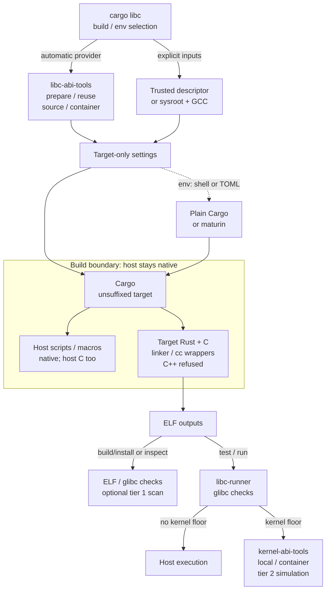

# Architecture

Maintained design reference for the implemented scope. The
[requirements index](docs/REQUIREMENTS.md) maps constraints and verification gaps;
[release index](docs/RELEASING.md#release-records) records the current registry baseline.

`cargo-libc` coordinates Cargo builds for a selected upstream glibc release on
x86_64 Linux. It supports dynamically linked executables and shared libraries
(`cdylib`), including Python extensions. Other architectures and C libraries,
static linking and provider-backed PIE executables are not supported.

The original `cargo-glibc` prototype used a complete target sysroot. That path
remains available, but generated providers are now implemented and selected by
default. Historical validation is retained in
[PROTOTYPE-VALIDATION.md](docs/PROTOTYPE-VALIDATION.md); current workflows and
limits belong in the [user guide](docs/USER-GUIDE.md), and open work in the
[roadmap](docs/ROADMAP.md).

## Implemented build and execution flow

Solid arrows show implemented control/data flow for Cargo commands. The dotted
`env` edge exports settings; it does not perform a build or post-build inspection.

`build` checks its selected Cargo-reported executable; `install` checks the
executables it built **after installation**. Plain Cargo/maturin outputs,
including `cdylib`, require separate `inspect`; `inspect` also accepts existing
ELF files independently of this build path. The target wrappers are
`libc-linker` and `libc-cc`; a full sysroot requires its GCC runtime inputs.
Optional tier 1 scanning is delegated to `linux-abi-scan`. Host units never use the provider's
target linker. The provider builder embeds `glibc-abilists` and
`glibc-provider-sources` inputs; imported descriptors remain trusted local inputs,
not authenticated SDKs. Container execution uses its image's userland and the
modern host kernel, not a real old kernel.

**Outside the implemented flow:** `prebuilt` remains unavailable pending legal
review; other architectures/libcs are planned. Real old-system tier 3
qualification is deferred, not complete and not an ordinary-release blocker.
No arrow represents delivery of those capabilities.

Source backing: [selection/delegation](src/cli.rs),
[Cargo settings, artifact checks and exports](src/toolchain.rs),
[host/target C dispatch](src/cc.rs), [ELF reporting](src/report.rs) and
[runner checks/plans](src/simulate.rs). Relevant existing requirements are
CL-REQ-003/005–008/010–013/015–017/020/024–025 in the
[trace index](docs/REQUIREMENTS.md#requirements). The diagram is an implementation
map, not additional runtime qualification or a new contract.

## Coordinator and dependencies

`src/cli.rs` parses the target selection. `src/toolchain.rs` probes build inputs,
sets target-only Rust flags and invokes Cargo with an explicit unsuffixed
`x86_64-unknown-linux-gnu` target. Host build scripts and procedural macros stay
native. A version suffix such as `.2.17` is cargo-libc syntax, not a Cargo target.

The Rust implementation uses std and first-party rustcommons crates from
crates.io. The companion repository
[linux-abi-tools](https://github.com/rustcommons/linux-abi-tools) publishes distinct
crates with these responsibilities:

- `libc-abi-tools`: provider preparation, cache management and ABI stub generation;
- `linux-targets`: glibc/kernel selections and distribution presets;
- `linux-abi-scan`: tier 1 static scanning;
- `kernel-abi-tools`: kernel facts and tier 2 syscall simulation.

cargo-libc delegates provider preparation to `libc-abi-tools`; it does not
implement a second provider builder. It uses the host Clang driver, GNU `ld` and
GCC inputs rather than implementing a compiler or linker.

## Provider and sysroot inputs

An automatic provider supplies the selected release's headers, startup and
nonshared objects, link-only glibc DSOs, and a `libgcc_s` stub. Releases 2.17
through 2.44 are supported. The provider cache has two available build modes:

- **Source (default):** compile recorded glibc startup sources with the host GCC,
  verify the objects against the qualified build, and cache the result. The
  embedded inputs allow preparation offline. This mode does not build a real
  glibc runtime.
- **Container:** run the pinned container build using podman or docker. This can
  download images and requires the container tooling. It supplies a real target
  runtime as well as link inputs.

A refused mode never silently falls back to another. `prebuilt` mode remains
unavailable pending legal review. An explicit `--provider` consumes the existing
[six-field descriptor](docs/PROVIDER-CONTRACT.md); `--sysroot` with
`--gcc-runtime` instead uses a complete target development filesystem. In sysroot
mode, the glibc selection is a checked ceiling, not a mechanism for downgrading
that filesystem's interfaces.

Provider paths and selection enter Cargo's fingerprints, but this is not a hash
of every input. Changing files in place requires a clean build or new target
directory. Descriptors are trusted local inputs, not authenticated, relocatable
SDK manifests. Full ABI validation and provider provenance belong to the producer;
the consumer checks descriptor paths, required files and header versions.

### Data, source and licensing boundaries

The provider's ABI lists come from glibc's signed release tags, collected with
per-release and per-file provenance by
[glibc-abilists](https://github.com/rustcommons/glibc-abilists). The
`glibc-provider-sources` crate, published from
[glibc-provider](https://github.com/rustcommons/glibc-provider), supplies recorded
glibc startup sources and headers, together with the builders' Linux UAPI headers.
These are embedded through `libc-abi-tools`' default features.

This repository's source is MIT licensed and contains no copied glibc data or Zig
source. The built tool includes glibc material under LGPL-2.1-or-later and UAPI
headers under their individual licenses. See [NOTICE.md](NOTICE.md) and the input
crates' notices for attribution and provenance. Zig's contributors inspired the
ABI-provider approach; its data format is not a protocol consumed by cargo-libc.

Link-only stubs describe symbol names, versions, kinds and sizes. They are not
runtime implementations and must never replace the destination's real libraries.
Startup/nonshared objects contain real code, while GCC startup and compiler
runtime inputs have separate responsibilities. Renaming version requirements in
a finished binary cannot substitute for these inputs or supply missing APIs.

## Linker and C compiler helpers

`libc-linker` forwards arguments to Clang without a shell. With a provider it
supplies startup objects, stubs and nonshared archives explicitly. Executables
use `crt1.o`, GCC's `crtbegin.o`/`crtend.o`, and the target loader path, with
`-nostdlib -no-pie`. Shared libraries omit `crt1.o` and the loader and use
`crtbeginS.o`/`crtendS.o`. The existing sysroot path lets Clang select inputs from
the configured target filesystem. The [build-control reference](docs/USER-GUIDE.md#how-the-build-is-controlled)
describes flags and input order.

`libc-cc` configures target C compilation through `cc` and CMake with matching
headers and link inputs. It distinguishes host and target units through
`CARGO_CFG_CARGO_LIBC_PROFILE`, not the triple: Cargo uses the same triple for
both. Host C retains its native compiler. `libc-cxx` refuses target C++ until a
target C++ runtime exists. pkg-config and host system-library dependencies are
not configured for the target. Header selection matters because stubs cannot
repair C code compiled against incompatible declarations or layouts.

## Artifact inspection and Cargo workflows

`build` matches the executable named by `--artifact` against Cargo's reported
artifacts, including fresh cache hits. `install` checks every executable it built
after Cargo installs them. `check`, `clippy` and `doc` do not validate final
artifacts; `rustc` may link but also requires separate inspection.

`env` emits shell exports or a Cargo configuration file for plain Cargo and tools
such as maturin. Generated paths are machine-specific. These workflows still
need the unsuffixed Cargo target and separate `inspect` calls, including for
`cdylib` outputs. See [Plain Cargo and CI](docs/USER-GUIDE.md#plain-cargo-and-ci)
and [Python extensions](docs/USER-GUIDE.md#python-extensions-maturin).

The bounded Cargo JSON reader extracts executable identities. The ELF reader
uses program headers and dynamic metadata rather than scraping `readelf` or
requiring section headers. It reports interpreter/search paths, dependencies and
version requirements. It checks direct requirements only, not the transitive
shared-library closure, `dlopen` plugins, C++ runtime compatibility or CPU needs.

With a kernel floor, `build`, `install` and `inspect` add the tier 1 scan from
`linux-abi-scan`. The scan uses section headers, dynamic symbols and code as well
as kernel facts shared with `kernel-abi-tools`. Imported syscall wrappers and
`DT_RELR` are exact findings; constant syscall and `madvise` call sites are
heuristic. Tier 1 is the least reliable tier and cannot prove runtime behavior.

## Execution and qualification limits

`test` and `run` configure `libc-runner` as Cargo's target runner, leaving host
build scripts and procedural macros native. Each target binary is checked
against the selected glibc ceiling. For host execution, the helper also compares
non-weak version requirements with the definitions in the host libraries the
loader would use, refusing known missing versions and warning when it cannot tell.

Without a kernel floor, execution stays on the host. With `--distro` or
`--kernel`, tier 2 uses either a local seccomp filter (host userland, no root) or
a container (the image's userland, the host's kernel). Unsupported syscalls return
`ENOSYS`; unknown `madvise` advice returns `EINVAL`. This simulates availability,
not every old-kernel behavior. `doctor` probes runners by starting processes under
these filters/profiles and can also probe build inputs; see its
[selection rules](docs/USER-GUIDE.md#provider-doctor).

Neither tier 1 nor tier 2 qualifies an application for a real old system. Tier 3
requires execution on the actual target, including its dependencies and exercised
code paths. [VALIDATION.md](VALIDATION.md) records evidence and its limits;
[the roadmap](docs/ROADMAP.md) separates remaining qualification, dependency
closure, provider distribution and platform expansion from implemented behavior.

## Primary references

- [cargo-zigbuild's Rust package](https://github.com/rust-cross/cargo-zigbuild/blob/main/Cargo.toml)
- [Zig glibc stubs, headers, and real CRT/nonshared components](https://codeberg.org/ziglang/zig/src/branch/master/lib/libc/glibc/README.md)
- [libc ABI collection tooling and dataset format](https://codeberg.org/ziglang/libc-abi-tools)
- [Cargo Rust flag precedence](https://doc.rust-lang.org/cargo/reference/config.html#buildrustflags)
- [Cargo host/target linker behavior](https://doc.rust-lang.org/cargo/reference/unstable.html#target-applies-to-host)
- [Clang driver options](https://clang.llvm.org/docs/ClangCommandLineReference.html)
- [GNU linker documentation](https://sourceware.org/binutils/docs/ld/)
