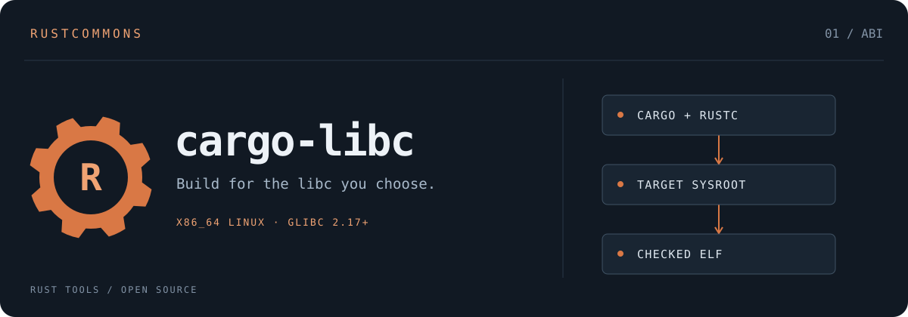

# cargo-libc

**Build for the libc you choose.**

[](https://github.com/rustcommons/cargo-libc/actions/workflows/ci.yml)

[](LICENSE)
[](https://crates.io/crates/cargo-libc)
[](https://docs.rs/cargo-libc)

A Cargo subcommand that builds Rust programs on a current x86_64 Linux machine for
an older glibc, 2.17 through 2.44. It links against exactly what the release you
choose defines, checks what the result requires, and can run your tests under a
simulation of the target's kernel. It supports dynamically linked executables and
shared libraries (`cdylib`); other architectures and C libraries are planned.

## Installation

Requirements are an x86_64 Linux host, Rust 1.90 or later, a Clang that supports
`--gcc-install-dir`, GNU binutils, and GCC. See
[Install](docs/USER-GUIDE.md#install). The five installed executables (`cargo-libc`,
`libc-linker`, `libc-runner`, `libc-cc`, `libc-cxx`) must stay in one directory.

```sh
cargo install cargo-libc --locked
```

**Continue with the [user guide](docs/USER-GUIDE.md)** for the quick start, target
selection, every command, C dependencies, Python extensions, CI and troubleshooting.

## What it does

- **Links for one glibc release.** The provider for a release has its headers and
  startup objects, plus link-only stubs of glibc's libraries with exactly that
  release's symbols and versions. An interface newer than your target fails at link
  time, on your machine. cargo-libc prepares the provider itself: by default it
  compiles glibc's startup sources, which are built into the tool, with your GCC.
  It verifies every object against the build CI qualified, and caches the
  provider. See
  [Using glibc providers](https://github.com/rustcommons/linux-abi-tools/blob/main/docs/USING-PROVIDERS.md).
- **Checks the result.** `build` and `install` check that the executables they
  produce require no newer `GLIBC_*` version, and `inspect` checks any ELF file.
  With a kernel floor they also run a static scan (tier 1, the least reliable
  tier).
- **Simulates the target kernel.** `test` and `run` run every binary through a
  seccomp filter, or a container, that makes syscalls the target kernel lacks
  return `ENOSYS` (tier 2).
- **Covers the whole Cargo workflow.** It supports `build`, `check`, `clippy`,
  `doc`, `rustc`, `test`, `run` and `install`, and `env` configures plain Cargo
  for CI or other tools.
- **Builds Python extensions.** A PyO3 extension built by maturin with the
  `cargo libc env` settings can target an older glibc; see
  [Python extensions](docs/USER-GUIDE.md#python-extensions-maturin).
- **Builds C dependencies for the target.** C built through the `cc` crate or
  CMake gets the target's headers and links against its stubs. Build scripts and
  procedural macros stay native.

It is written in Rust with only the standard library and first-party rustcommons
crates. It uses your `rustc`, a Clang driver and GNU `ld`, and needs no Zig,
Python or downloaded SDK.

## Status

This is an early release (0.2). Hosted CI, on every push:

- builds, checks, runs and inspects with the automatic provider for every release
  2.17–2.44, including C dependencies and every command;
- in [linux-abi-tools](https://github.com/rustcommons/linux-abi-tools), qualifies
  container and source providers for every release
  ([PROVIDERS](https://github.com/rustcommons/linux-abi-tools/blob/main/docs/PROVIDERS.md)).

What CI does not do is run your program on a real old system: tier 3 is yours. See
[VALIDATION.md](VALIDATION.md) for what was tested, [Limits](docs/USER-GUIDE.md#limits),
and the [roadmap](docs/ROADMAP.md).

## Source map

| File | Role |
| --- | --- |
| `src/cli.rs` | Command parsing; automatic providers through `libc-abi-tools` |
| `src/toolchain.rs` | Input probes, target flags, Cargo execution, the linker and C compiler drivers, artifact checks, `env` |
| `src/cc.rs`, `src/bin/libc-cc.rs`, `src/bin/libc-cxx.rs` | C compiler wrappers for target C dependencies |
| `src/simulate.rs`, `src/bin/libc-runner.rs` | Tier 2 target runner: glibc checks, then the local filter or a container |
| `src/report.rs` | glibc assessment, tier 1 scan, human and JSON reports |
| `src/elf.rs`, `src/cargo_output.rs`, `src/version.rs` | Bounded ELF reader, Cargo JSON messages, versions |
| `src/provider.rs` | Provider descriptor (v1) |
| `examples/` | CI fixtures: `hello` (host build script, proc macro, threads), `c-deps`, `python-ext` (PyO3 and maturin), `too-new` |

## Credits and licensing

cargo-libc began as the MIT-licensed `cargo-glibc` prototype. Providers come from
`libc-abi-tools` in [linux-abi-tools](https://github.com/rustcommons/linux-abi-tools).
That approach is inspired by the work of **Zig's contributors** on glibc support.

The tool's glibc data comes from glibc itself, through two crates:

- ABI lists from glibc's signed release tags, via
  [glibc-abilists](https://github.com/rustcommons/glibc-abilists);
- startup sources and headers, via
  [glibc-provider-sources](https://github.com/rustcommons/glibc-provider).

Both are LGPL-2.1-or-later and compiled into the `cargo-libc` executable. This
package's source is MIT licensed and contains no glibc files. [NOTICE.md](NOTICE.md)
has the full attribution and what the built tool contains.

Design references:

- [Cargo configuration](https://doc.rust-lang.org/cargo/reference/config.html#buildrustflags);
- [same-triple host behavior](https://doc.rust-lang.org/cargo/reference/unstable.html#target-applies-to-host);
- [JSON messages](https://doc.rust-lang.org/cargo/reference/external-tools.html#json-messages);
- [rustc codegen options](https://doc.rust-lang.org/rustc/codegen-options/index.html);
- [Clang options](https://clang.llvm.org/docs/ClangCommandLineReference.html);
- [Zig's glibc design](https://codeberg.org/ziglang/zig/src/branch/master/lib/libc/glibc/README.md);
- [ELF symbol versioning](https://refspecs.linuxfoundation.org/LSB_3.1.1/LSB-Core-generic/LSB-Core-generic/symversion.html).
